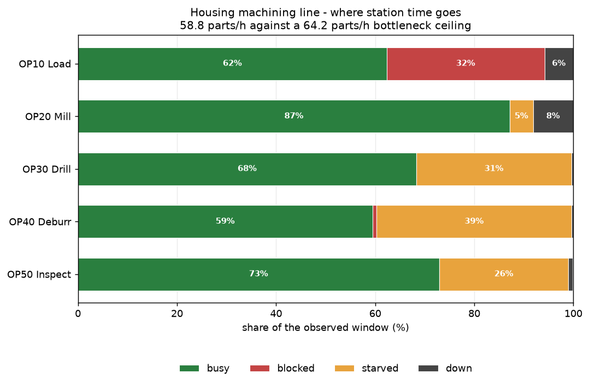
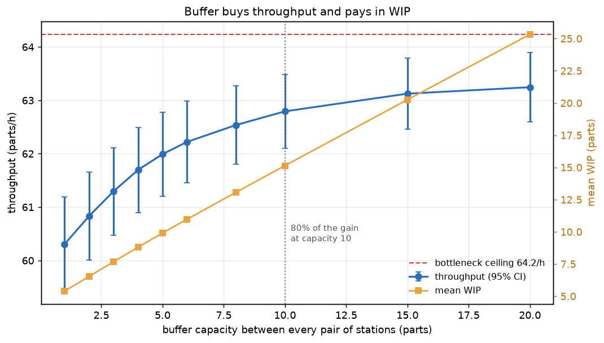
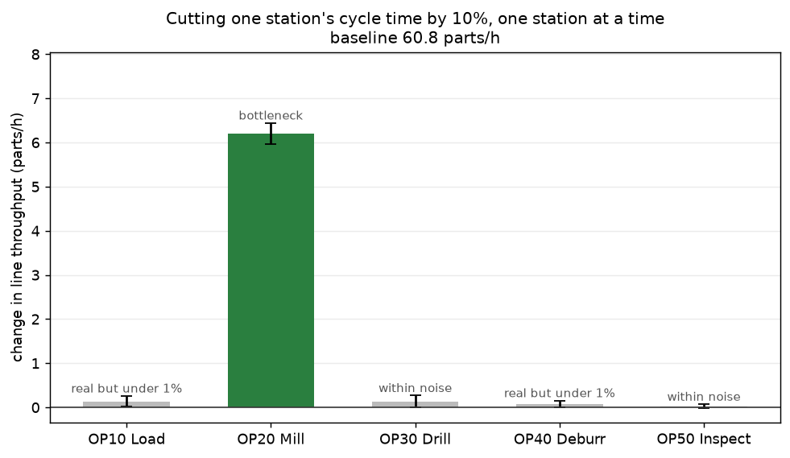
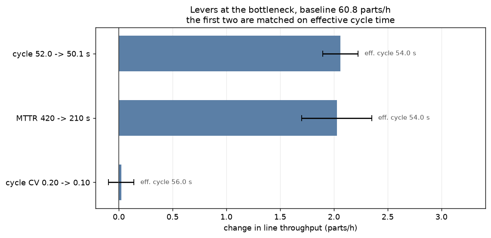

# Production Line Simulation

A **discrete-event model** of a five-station machining line with finite
buffers, stochastic cycle times and machine failures — built to answer the
three questions a line actually raises: how much buffer, where improvement
pays, and whether to buy speed or reliability.

```bash
pip install -r requirements.txt
python run.py                 # run, experiments, figures, report (~40 s)
python run.py --quick         # smoke test
python tests/test_line.py     # 27 checks, ~6 s
```

Built with **SimPy**. The line is defined in `data/line.json`, so changing the
process means editing a file, not the model.

---

## The line, on one shift



```
throughput         58.75 parts/h
bottleneck ceiling 64.23 parts/h  (OP20 Mill)
line efficiency    91.5%
good parts         470            scrap 8
mean WIP            6.17 parts
mean flow time      6.2 min
```

Every station has spare capacity. Nothing is overloaded. The line still runs
**5.5 parts/h under its own bottleneck**, and that gap is the point of the
whole exercise: it is not downtime — the downtime is already priced into the
64.2 ceiling — and no amount of fixing machines removes it. It is the cost of
variability meeting finite buffers.

Read the chart by colour and the bottleneck locates itself: **OP10 is blocked
32% of the shift** because the buffer in front of the mill is full, and
**everything downstream is starved** — OP40 for 39% of the shift — because the
mill has not released work yet. Red upstream, orange downstream, and the
pace-setter in between with almost neither. That diagnosis needs no process
sheet, which matters, because on a real line nobody hands you one.

`src/metrics.py` does it both ways and the answers agree:

```
analytic bottleneck : OP20 Mill   (slowest effective cycle, 56.0 s)
observed bottleneck : OP20 Mill   (waits on nobody)
```

Ranking by **effective** cycle time rather than nameplate is what makes the
analytic answer right. OP20 is a 52 s machine, but at 92.8% availability it is
a 56.0 s machine, and a fast unreliable station outranking a slow reliable one
is the ordinary case, not a corner case.

## 1. How much buffer?



| capacity | throughput (parts/h) | mean WIP | flow time | marginal parts/h per WIP part |
|---|---|---|---|---|
| 1 | 60.31 ± 0.88 | 5.40 | 5.3 min | — |
| 2 | 60.83 ± 0.83 | 6.54 | 6.3 min | +0.461 |
| 5 | 61.99 ± 0.79 | 9.91 | 9.4 min | +0.269 |
| 10 | **62.79 ± 0.69** | 15.14 | 14.2 min | +0.124 |
| 20 | 63.25 ± 0.65 | 25.33 | 23.5 min | +0.024 |

Going from one buffer slot to twenty buys **2.94 parts/h — 4.9%** — and costs
**4.7× the WIP** and **4.4× the flow time**. The last column is the decision:
the first extra part of WIP returns 0.46 parts/h, the last returns 0.024, a
factor of nineteen worse.

There is no sharp knee here, and I had to change the code to say so. The first
version looked for the smallest capacity within 1% of the best throughput —
on a curve this gradual that criterion just returns the largest capacity you
happened to test and calls it a knee. Measuring against the gain actually on
offer is honest either way, and the honest reading on this line is that
**buffer is a weak lever**: it cannot beat the ceiling, only approach it, and
flow time is how long a quality problem stays undetected on the line.

## 2. Where does improvement pay?



Cut one station's cycle time by 10%, one station at a time, 12 replications
each:

| station made 10% faster | paired change | verdict |
|---|---|---|
| OP10 Load | +0.14 ± 0.12 | real but under 1% |
| **OP20 Mill** | **+6.20 ± 0.24** | **material (+10.2%)** |
| OP30 Drill | +0.13 ± 0.14 | within noise |
| OP40 Deburr | +0.08 ± 0.07 | real but under 1% |
| OP50 Inspect | +0.03 ± 0.05 | within noise |

Improving the bottleneck by 10% improves the line by 10%. Improving anything
else achieves, at most, a fifth of one percent.

The accounting version is sharper than the statistics, because it needs no
replications at all. Speed up OP30 by 10% on one seed and compare the two runs
directly:

```
OP30 busy     19 678 s  ->  17 710 s   (1 968 s of work removed)
OP30 starved   9 494 s  ->  11 472 s   (1 978 s of extra idling)
parts out          479  ->       479   (identical)
```

The saving did not become output. It became idle time, to within eleven
seconds, and the line produced the same part count — the same parts, in the same order,
at the same moments. That is Goldratt's theory of constraints as an assertion
in the test suite rather than a slogan.

**Two caveats I had to add rather than ignore.** First, OP10 and OP40 do show a
real effect, just a tiny one: with finite buffers a faster neighbour refills
the bottleneck's buffer slightly sooner after a repair, so "non-bottlenecks
don't matter" is an excellent approximation, not an identity. Second, the
paired comparison is sensitive enough to resolve **0.08 parts/h**, which makes
"statistically significant" a weak standard — so the report separates
*significant* from *material* (≥1% of throughput). Reporting only the first is
how a 0.2% gain gets written up as an improvement.

## 3. Speed, reliability, or variability?



Three ways to spend money on the bottleneck. The first two are **matched on
effective cycle time**, so a capacity calculation prices them identically:

| lever at OP20 Mill | effective cycle | paired change | verdict |
|---|---|---|---|
| cycle 52.0 → 50.1 s | 54.0 s | +2.06 ± 0.17 | material |
| MTTR 420 → 210 s | 54.0 s | +2.03 ± 0.33 | material |
| cycle CV 0.20 → 0.10 | 56.0 s | +0.02 ± 0.12 | within noise |

The matched pair really is interchangeable here — +2.06 against +2.03, well
inside each other's intervals. Buying a faster spindle and fixing the repair
process bought the same throughput, so the decision is purely about cost.

The third result is the one I expected to go the other way. The textbook
lesson is that variability is the free lever, invisible to the capacity
calculation; halving the mill's cycle-time variability does **nothing
measurable** on this line. The reason is in the first chart: the mill is busy
87% and starved only 5%, so its cycle jitter is absorbed by the buffers, while
the variability that genuinely costs throughput is the **failure** process —
8% downtime arriving in 7-minute blocks. Both are "variability"; only one of
them is this line's problem. Halving MTTR *is* the variability lever here, and
it is already in the table.

## Two things that make the numbers trustworthy

**Common random numbers.** Every variant runs on the same seeds, and each
station draws from its **own** stream for cycle times, failures, repairs and
scrap. With one shared generator, making station 2 faster changes how many
draws it takes, which shifts every later draw — so station 5's failures land
at different times and the measured difference is partly that reshuffle. The
symptom was unmissable: the first buffer sweep was **not monotone**, showing
58.7 at capacity 1 and 58.4 at capacity 2, which is impossible, since extra
buffer cannot make a line worse. Splitting the streams made it monotone at
every horizon tested. It did **not** shrink the intervals on absolute
throughput — those are independent-sample intervals and only a longer horizon
moves them, which is why the experiments run 40 h rather than 8 h, taking
±2.4 down to ±0.8. What common random numbers buy is the *paired* comparison
in the next paragraph. `test_more_buffer_never_reduces_throughput`
is the regression test, and `test_streams_are_independent_between_stations`
asserts the property directly.

**Paired comparisons.** Because the seeds are shared, replication *k* of the
improved line and replication *k* of the baseline differ only by the change.
The right statistic is the mean of the differences, not the difference of the
means: the baseline's own run-to-run spread is ±0.83 parts/h, while the paired
interval on the mill's +6.20 is **±0.24**. Comparing two independent intervals
instead would have called a real 10% improvement "noise" — and did, before I
fixed it.

## Modelling decisions worth defending

**Failures consume operating time, not calendar time.** A starved machine is
not wearing out. Time to failure is sampled in operating seconds and
decremented only while the station is cutting; a failure landing mid-part
interrupts it, repairs, and then *finishes* the part rather than restarting
it, because the material is still in the fixture.
`test_downtime_costs_exactly_the_availability_formula` pins this to the closed
form: a 10 s cycle at MTBF 100 s / MTTR 100 s must settle at exactly 180
parts/h, not 360.

**Warm-up is discarded.** Measuring from t=0 averages in an empty line filling
up. Statistics reset at the end of the warm-up, and a charge that straddles
the boundary is **clipped** to the window — otherwise a repair that started
during warm-up and ended inside the window contributes its whole duration to a
window it was only partly in, which on this line is over a percent.

**Buffer capacity 1 is the minimum, not 0.** A SimPy `Store` needs capacity
≥ 1. True zero-buffer operation — a part can only move if the next machine is
free — is a different model, and the sweep says so rather than pretending.

**The shift and the experiments report different baselines.** The headline is
one 8 h shift (58.75 parts/h) because that is the window a shift gets
reported in. The experiments use 12 replications of 40 h (baseline 60.83
parts/h) because eight hours is far too short to separate two configurations —
the failure process alone puts a couple of parts/h of noise on the answer. The
two numbers differ for that reason and no other.

## Layout

| File | Role |
|---|---|
| `src/line.py` | The SimPy model: stations, buffers, blocking, starving, failures. |
| `src/metrics.py` | Bottleneck detection, Little's law, confidence and paired intervals. Pure. |
| `src/experiments.py` | The three experiments. Pure. |
| `src/charts.py`, `src/report.py` | Four figures and a printable PDF report. |
| `src/paper.py` | Page composition: A4 pages, tables, figure bands. |
| `run.py` | Everything, in order. |
| `data/line.json` | The process: cycle times, CVs, MTBF/MTTR, scrap, buffers. |

## Testing

```
27/27 passed   (6 s, no pytest required)
```

Closed-form anchors and invariants, not golden output:

- a single 36 s station makes **exactly** 100 parts/h; a 10/20/15 s line makes
  **180** — the slowest station, not the average
- a 10 s station feeding a 20 s station is busy exactly **50%** of the time and
  blocked for the rest
- MTBF 100 s / MTTR 100 s is **availability 0.50**, so a 10 s cycle gives 180
  parts/h, asserted on the model's own failure mechanism
- **Little's law** holds to under 2% — a conservation identity, not a model
  output, and the sharpest single check that the WIP and flow-time bookkeeping
  agree
- every station's busy + blocked + starved + down **fills the window**, short
  only by the one activity still in flight when it closed
- more buffer **never** reduces throughput (the test that caught the shared-RNG
  bug)
- improving a non-bottleneck moves the line by **less than 0.5 parts/h**, and
  the removed work reappears as starvation within eleven seconds
- a paired interval on two samples differing by a constant has **zero width**,
  while the unpaired intervals overlap completely

One test needed fixing twice, which is worth recording. The availability check
first asserted ±3.0 parts/h on a single 200 h run. A single run of that length
carries a standard deviation of 2.4 parts/h, so the bound was 1.25σ — it
failed on roughly a fifth of seeds, and a bound loose enough to pass reliably
would not have caught a 2% error in the failure model. The fix was not a wider
tolerance but ten replications, which brings the standard error under 0.8. The
model was correct all along: 180.006 parts/h over 2000 h.

## Fachbegriffe

| English | Deutsch |
|---|---|
| Discrete-event simulation | Ereignisdiskrete Simulation |
| Production line / flow line | Fließfertigung / Fertigungslinie |
| Bottleneck | Engpass |
| Buffer / intermediate store | Puffer / Zwischenlager |
| Blocking / starving | Blockierung / Verklemmung |
| Cycle time / takt time | Taktzeit |
| Throughput | Durchsatz |
| Work in progress | Umlaufbestand (WIP) |
| Flow time / throughput time | Durchlaufzeit |
| Availability | Verfügbarkeit |
| Mean time between failures / to repair | Mittlere Betriebsdauer zwischen Ausfällen / Reparaturdauer |
| Utilisation | Auslastung |
| Scrap | Ausschuss |
| Capacity planning | Kapazitätsplanung |
| Theory of constraints | Engpasstheorie |

## Scope

The line is invented; the modelling is not. Buffers block, starvation
propagates, failures consume operating time, warm-up is discarded, comparisons
are paired, and every figure quoted above comes out of the seeded run that
`python run.py` reproduces.

Not implemented: shared resources between stations (one operator serving two
machines), setups and changeovers between part variants, parallel machines at
a station, rework loops back upstream, transport time between stations,
shift patterns and breaks, and optimisation — the buffer sweep is an
enumeration over a single shared capacity, not an allocation of a fixed
buffer budget across the four positions, which is the more interesting
problem and the first thing I would add.

The model also assumes failures are independent across stations. On a real
line they are not: a tool-breakage upstream and a scrap spike downstream are
usually the same event.

---

Built by [Prathamesh Bedre](https://github.com/Pratsss24) — M.Sc. Intelligent
Manufacturing, TU Clausthal. Companion repos:
[cmm-spc-dashboard](https://github.com/Pratsss24/cmm-spc-dashboard) (capability
and control charts from CMM data),
[tolerance-stackup](https://github.com/Pratsss24/tolerance-stackup) (worst
case, RSS and Monte Carlo) and
[opcua-machine-monitor](https://github.com/Pratsss24/opcua-machine-monitor)
(OPC UA → historian → OEE).
